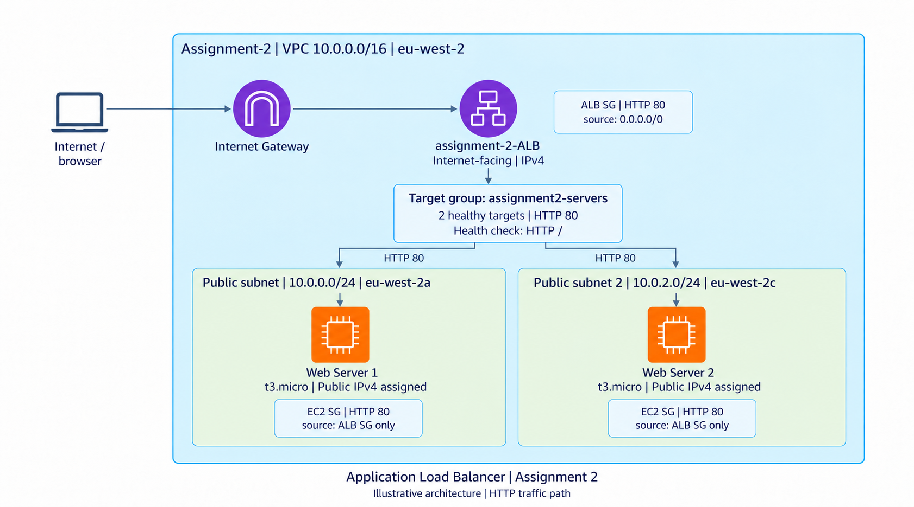

# Assignment 2 - Application Load Balancer evidence

These screenshots document the AWS console build and browser tests on **23 October 2026**. Two `t3.micro` EC2 instances in the same VPC run in `eu-west-2a` and `eu-west-2c`. Both are healthy targets, and the ALB DNS name returns different content from each server. Cleanup has not been confirmed.

This is an architecture illustration, not an AWS console screenshot. The actual ALB network mapping is screenshot 4; registered targets and the `/` health check are screenshots 6 and 7. The illustration shows the HTTP traffic path and intended Security Group attachments. Screenshots 1–11 follow the ALB build and test sequence. Screenshots 12–30 document the earlier VPC build as labelled context.

## Screenshots

1. [EC2 web server 1](screenshots/01-ec2-web-server-1-running.png) — `Web-server-1-assignment2`, running `t3.micro` in `eu-west-2a`; private IPv4 `10.0.0.242`, with a public IPv4 address assigned.
2. [EC2 web server 2](screenshots/02-ec2-web-server-2-running.png) — `Web-server-2-assignment2`, running `t3.micro` in `eu-west-2c`; private IPv4 `10.0.2.99`, with a public IPv4 address assigned.
3. [Active Application Load Balancer](screenshots/03-alb-active-and-two-availability-zones.png) — `assignment-2-ALB` is `Active`, `Internet-facing`, and IPv4 in the same VPC as both instances.
4. [ALB network mapping](screenshots/04-alb-network-mapping-subnets-and-zones.png) — the console shows `10.0.0.0/24` in `eu-west-2a` and `10.0.2.0/24` in `eu-west-2c`.
5. [Target group summary](screenshots/05-target-group-two-healthy-targets.png) — `assignment2-servers`, instance targets on `HTTP:80`, with `2 Healthy` and `0 Unhealthy`.
6. [Registered EC2 targets](screenshots/06-registered-ec2-targets-both-healthy.png) — `i-01a84361324342609` in `eu-west-2a` and `i-05e339f4e95e1cdf7` in `eu-west-2c`; both registered on port `80` and `Healthy`.
7. [Root-path health check](screenshots/07-target-group-root-health-check-settings.png) — HTTP path `/`, traffic port, success code `200`, interval `30` seconds, timeout `5` seconds, healthy threshold `5`, and unhealthy threshold `2`.
8. [Saved ALB Security Group rules](screenshots/08-alb-security-group-inbound-rules.png) — `sg-06bf989c69cb15bbf` allows TCP `80` and `443` from `0.0.0.0/0` and `::/0`.
9. [Saved EC2 Security Group rules](screenshots/09-ec2-security-group-alb-source-only.png) — `assignment2-EC2-SG` allows TCP `80` and `443` only from the ALB Security Group. The instance attachments are a separate verification step.
10. [ALB response from Web Server 1](screenshots/10-alb-response-web-server-1.png) — the ALB DNS name returns `Response from Web Server 1`.
11. [ALB response from Web Server 2](screenshots/11-alb-response-web-server-2.png) — the same ALB DNS name returns `Response from Web Server 2`.
12. [Earlier VPC: VPC created](screenshots/12-vpc-created.png) — Assignment 1 context: `Assignment -1`, CIDR `10.0.0.0/16`; this VPC is reused by Assignment 2.
13. [Earlier VPC: public subnet](screenshots/13-vpc-public-subnet.png) — Assignment 1 context: `10.0.0.0/24`, `eu-west-2a`; this subnet is also mapped to the ALB.
14. [Earlier VPC: private subnet](screenshots/14-vpc-private-subnet.png) — Assignment 1 context: `10.0.1.0/24`, `eu-west-2b`; the ALB uses the separate `10.0.2.0/24` subnet in `eu-west-2c`.
15. [Earlier VPC: internet gateway setup](screenshots/15-vpc-internet-gateway-create-form.png) — Assignment 1 gateway creation form.
16. [Earlier VPC: internet gateway attachment](screenshots/16-vpc-internet-gateway-attach-form.png) — Assignment 1 form selecting the VPC for gateway attachment.
17. [Earlier VPC: unassociated Elastic IP](screenshots/17-vpc-elastic-ip-unassociated.png) — Assignment 1 earlier address detail; its public address is masked.
18. [Earlier VPC: NAT gateway setup](screenshots/18-vpc-nat-gateway-create-form.png) — Assignment 1 public NAT gateway creation form.
19. [Earlier VPC: public route table](screenshots/19-vpc-public-route-table-active.png) — Assignment 1 capture of the active `0.0.0.0/0` route to the Internet Gateway and public-subnet association.
20. [Earlier VPC: private route table setup](screenshots/20-vpc-private-route-table-create-form.png) — Assignment 1 route-table creation form.
21. [Earlier VPC: private route setup](screenshots/21-vpc-private-route-edit-form.png) — Assignment 1 edit form before the saved route was captured; screenshot 28 shows the later active route.
22. [Earlier VPC: public Security Group setup](screenshots/22-vpc-public-security-group-create-form.png) — Assignment 1 HTTP and SSH rules restricted to My IP; the source addresses are masked.
23. [Earlier VPC: public EC2 instance](screenshots/23-vpc-public-ec2-running.png) — Assignment 1 running `t2.micro`; this is the earlier instance, separate from the two Assignment 2 servers.
24. [Earlier VPC: Elastic IP list](screenshots/24-vpc-elastic-ip-list.png) — Assignment 1 address inventory with public address masked.
25. [Earlier VPC: public web endpoint](screenshots/25-vpc-public-web-endpoint.png) — Assignment 1 browser test displays `It works!`; the direct EC2 address is masked.
26. [Earlier VPC: final resource map](screenshots/26-vpc-final-resource-map.png) — Assignment 1 console map with two subnets, three route tables, Internet Gateway, and NAT Gateway.
27. [Earlier VPC: NAT gateway details](screenshots/27-vpc-nat-gateway-available.png) — Assignment 1 public NAT gateway is `Available`; its public address is masked.
28. [Earlier VPC: private route and association](screenshots/28-vpc-private-route-active-and-associated.png) — Assignment 1 active default route to the NAT gateway and explicit private-subnet association.
29. [Earlier VPC: route table inventory](screenshots/29-vpc-route-table-list-and-associations.png) — Assignment 1 public, private, and main route tables; the first row belongs to another VPC.
30. [Earlier VPC: EC2 instance list](screenshots/30-vpc-ec2-instance-list.png) — Assignment 1 public instance with both instance status checks passed; these are instance checks, separate from ALB target health.

**Remaining evidence:** the user-data scripts, the saved HTTP port 80 listener forwarding to `assignment2-servers`, each instance’s attached Security Groups and failed direct-access test, and the active Internet Gateway route for `public-subnet-2`. The saved ALB and EC2 Security Group rules are already shown in screenshots 8 and 9.

## Privacy

The original Desktop files and supplied attachments were left unchanged. Earlier VPC images reuse the existing redacted repository copies where available. Other console screenshots retain visible AWS account identifiers and public instance addresses. The architecture image is an illustration; the console evidence consists of the supplied screenshots.
