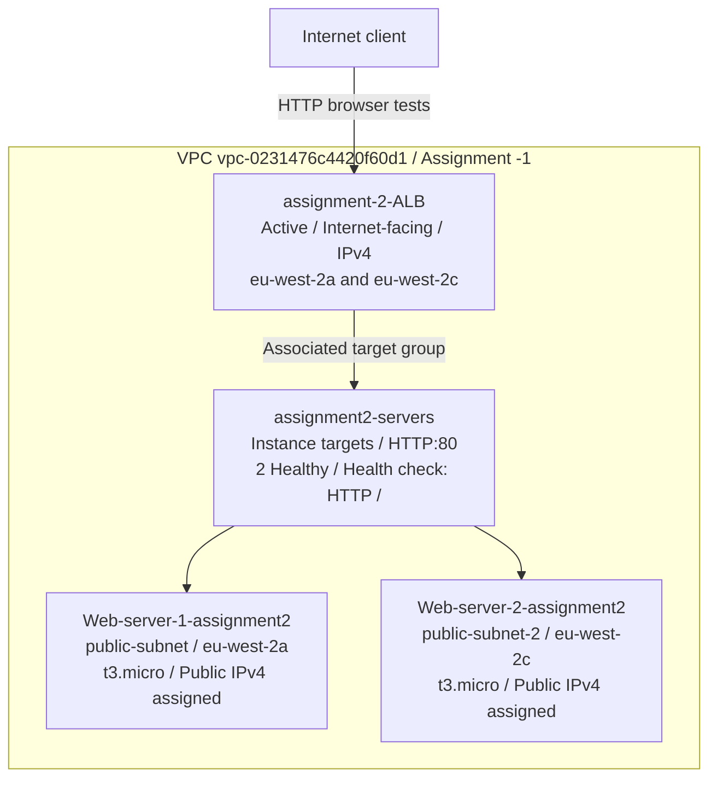
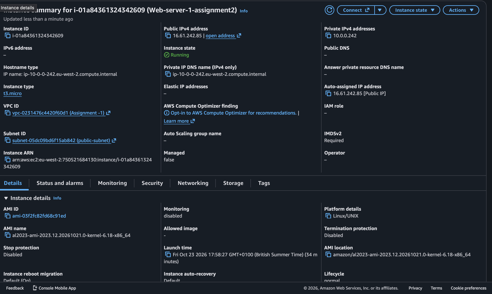
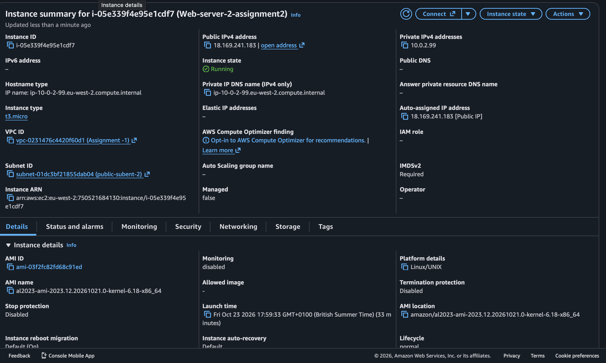
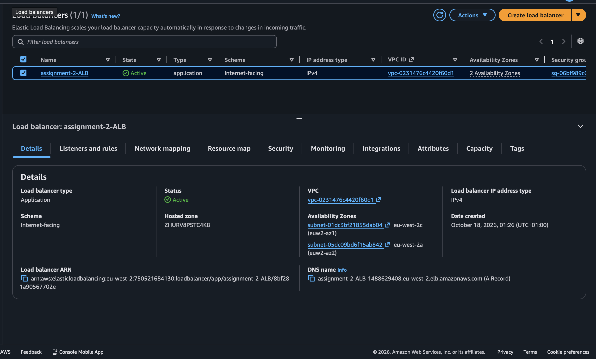
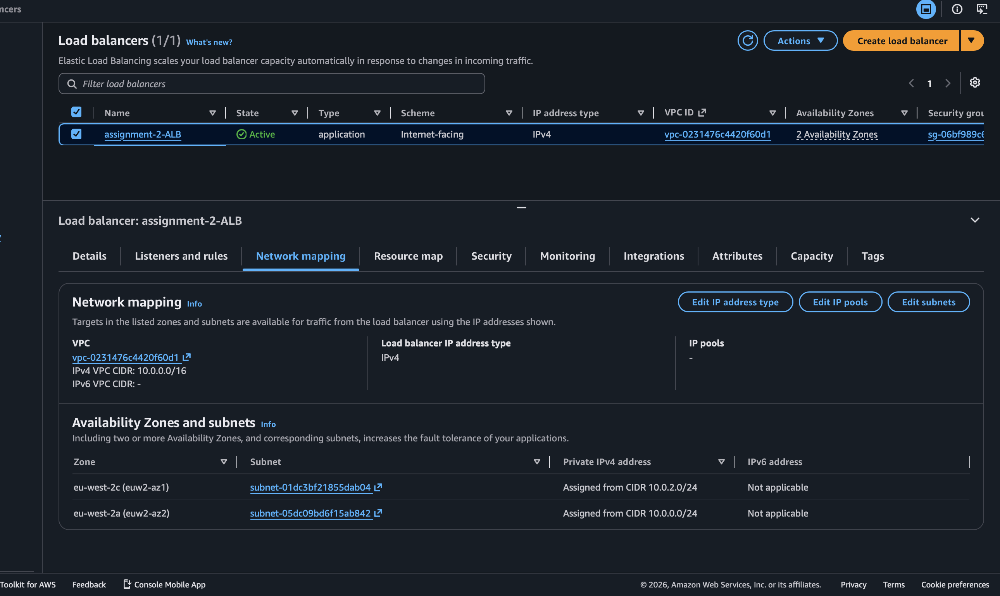
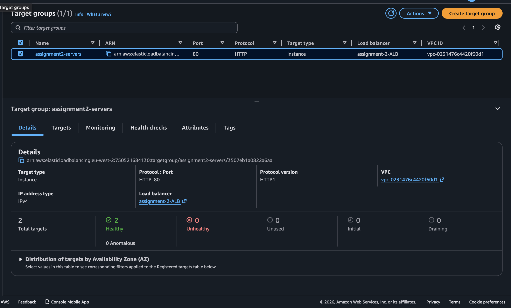
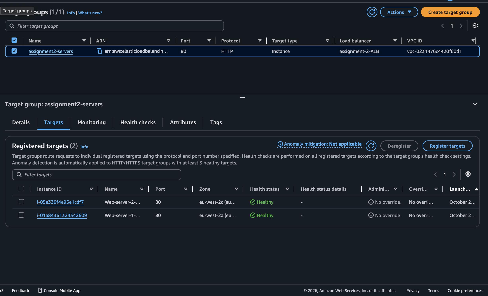
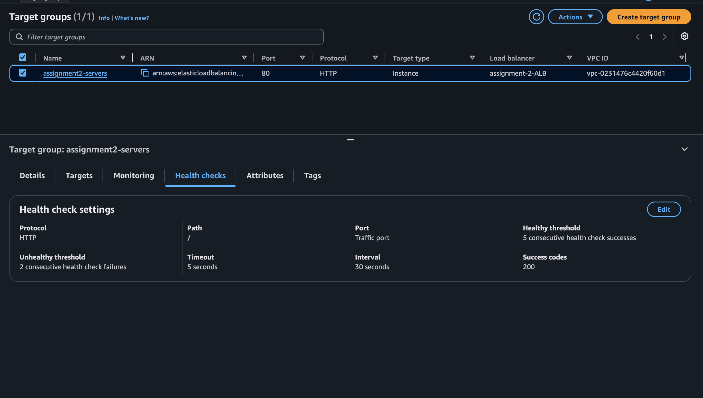
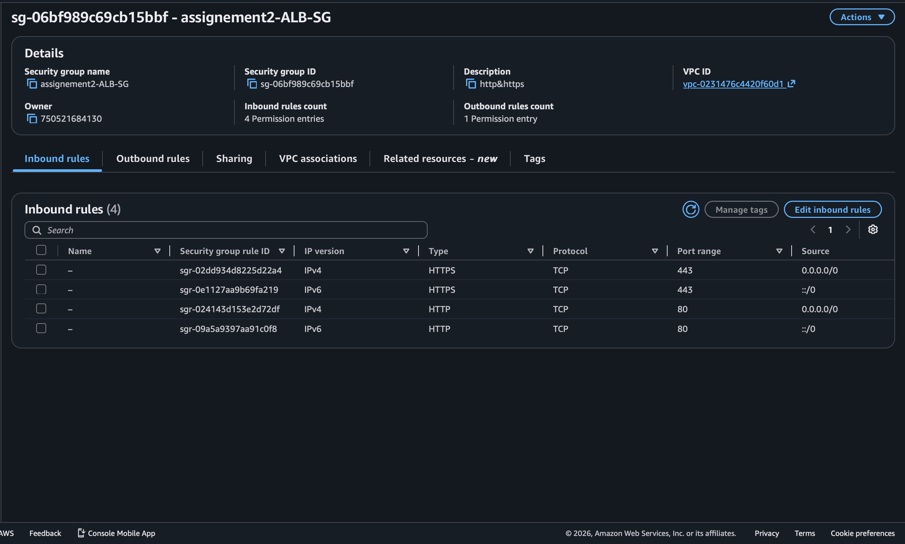
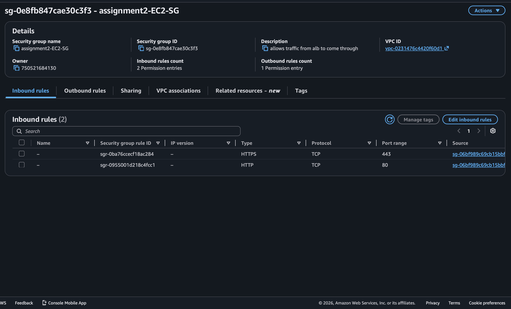

# Assignment 2 - Application Load Balancer evidence

This assignment demonstrates a common DevOps pattern: two EC2 web servers behind an Application Load Balancer (ALB), with the ALB acting as the public entry point.

The screenshots captured on **23 October 2026** show two running EC2 instances in the same VPC, an active internet-facing ALB across two Availability Zones, both named instances registered as **healthy targets**, an HTTP health check on **`/`**, and saved ALB and EC2 Security Group rules. The browser tests show the same ALB DNS name returning **Response from Web Server 1** and **Response from Web Server 2**.

This folder contains **33 screenshots**: the original 24-image Desktop collection and nine additional console captures. Screenshots **01–02 and 25–33** document Assignment 2; **03–21** document the earlier VPC assignment; **22–24** are other coursework and a Terraform browser test. The new captures confirm that Assignment 2 reuses the Assignment 1 VPC. The checklist at the end records the remaining evidence needed to verify every task.

[Back to the AWS assignments](../../readme.md#2-application-load-balancer)

## Objective

Deploy two EC2 instances in the same VPC, using different Availability Zones where possible. Install a simple web server through user data and give each instance a distinct response. Route incoming HTTP traffic through an ALB in two public subnets, and restrict the instances' HTTP access to traffic from the ALB Security Group.

## Assignment architecture



Screenshots 25–28 show the instances, ALB, and target-group association. Screenshot 32 confirms that both instance IDs are registered on port 80, are healthy, and run in `eu-west-2a` and `eu-west-2c`. Screenshot 31 confirms the HTTP health-check path `/`. Screenshot 33 records the ALB's two subnet mappings. The saved listener configuration remains to be captured.

## Recorded configuration

| Resource | Captured configuration | Screenshot |
| --- | --- | --- |
| VPC | `vpc-0231476c4420f60d1`, named `Assignment -1`, CIDR `10.0.0.0/16`; reused from Assignment 1 | 25–27, 33 |
| Web server 1 | `Web-server-1-assignment2`, `i-01a84361324342609`, running `t3.micro`, Amazon Linux 2023, private IPv4 `10.0.0.242`; public IPv4 assigned | 25 |
| Web server 1 subnet | `subnet-05dc09bd6f15ab842` / `public-subnet`, CIDR `10.0.0.0/24`, mapped to `eu-west-2a` | 25, 27, 33 |
| Web server 2 | `Web-server-2-assignment2`, `i-05e339f4e95e1cdf7`, running `t3.micro`, Amazon Linux 2023, private IPv4 `10.0.2.99`; public IPv4 assigned | 26 |
| Web server 2 subnet | `subnet-01dc3bf21855dab04` / `public-subnet-2`, CIDR `10.0.2.0/24`, mapped to `eu-west-2c` | 26, 27, 33 |
| Load balancer | `assignment-2-ALB`, Application, `Active`, `Internet-facing`, IPv4, with the two subnet mappings above | 27 |
| Target group | `assignment2-servers`, Instance targets, `HTTP:80`, `HTTP1`; associated with `assignment-2-ALB` | 28 |
| Target health | `2` total targets, `2 Healthy`, `0 Unhealthy`, `0 Unused`, `0 Initial`, `0 Draining` | 28 |
| Registered instance targets | `i-01a84361324342609` in `eu-west-2a` and `i-05e339f4e95e1cdf7` in `eu-west-2c`; both on port `80` and `Healthy` | 32 |
| Health check | HTTP, path `/`, traffic port (`80`), success code `200`, interval `30` seconds, timeout `5` seconds, healthy threshold `5`, unhealthy threshold `2` | 31 |
| ALB Security Group | `sg-06bf989c69cb15bbf`; inbound TCP `80` and `443` from both `0.0.0.0/0` and `::/0` | 29 |
| EC2 Security Group | `assignment2-EC2-SG`, `sg-0e8fb847cae30c3f3`; inbound TCP `80` and `443` only from `sg-06bf989c69cb15bbf` | 30 |

## Evidence summary

| Requirement | Evidence available | Status |
| --- | --- | --- |
| Visit the ALB DNS name over HTTP | Both browser screenshots show the same ALB hostname | Captured |
| Receive different content from the two web servers | Screenshot 01 shows Web Server 1; screenshot 02 shows Web Server 2 | Captured |
| Two EC2 instances in one VPC, preferably across two Availability Zones | Screenshots 25–26 show both running in the same VPC; screenshot 32 directly confirms their different Availability Zones | Captured |
| Install the web servers using user data | User-data configuration for each instance | Console evidence needed |
| Internet-facing ALB in two Availability Zones | Screenshot 27 shows the active Application Load Balancer; screenshot 33 shows both subnet mappings and their CIDRs | Captured |
| Both ALB subnets have public routing | Earlier screenshot 10 shows the Internet Gateway route for `public-subnet`; the route-table association and Internet Gateway route for `public-subnet-2` are still needed | Partly captured |
| HTTP port 80 listener forwards to the target group | The browser tests and `HTTP:80` target group are captured; the listener's saved forwarding rule is still needed | Console evidence needed |
| Target group has two healthy targets | Screenshot 28 shows `2 Healthy` out of `2` total targets | Captured |
| Both named EC2 instances are the registered targets | Screenshot 32 shows both matching instance IDs registered on port `80` and `Healthy` | Captured |
| Health check configured on `/` | Screenshot 31 shows the saved HTTP health check on `/`, traffic port, and success code `200` | Captured |
| ALB Security Group allows HTTP from anywhere | Screenshot 29 shows HTTP from `0.0.0.0/0` and `::/0` | Captured |
| EC2 Security Group allows HTTP only from the ALB Security Group | Screenshot 30 shows the saved source restriction | Rules captured; instance attachments needed |
| Direct internet access to EC2 is blocked | Both instances have public IPv4 addresses; their attached Security Groups and a failed direct HTTP connection test are still needed | Evidence needed |

Screenshots 28 and 32 confirm target health at capture time. The ALB and EC2 Security Group rule screenshots are already supplied as 29–30. The remaining security evidence concerns the groups attached to each instance and a direct-access test.

## Screenshots

The index covers all 33 screenshots. The Assignment 2 gallery follows the build sequence: instances, ALB and network mapping, registered targets and health checks, Security Groups, then browser tests. Every image has a numbered filename, a descriptive caption, and its original filename in the source index.

01. [ALB response — Web Server 1](screenshots/01-alb-response-web-server-1.png) — ALB.
02. [ALB response — Web Server 2](screenshots/02-alb-response-web-server-2.png) — ALB.
03. [VPC created](screenshots/03-vpc-created.png) — VPC.
04. [Public subnet](screenshots/04-vpc-public-subnet.png) — VPC.
05. [Private subnet](screenshots/05-vpc-private-subnet.png) — VPC.
06. [Internet gateway setup](screenshots/06-vpc-internet-gateway-create-form.png) — VPC.
07. [Internet gateway attachment](screenshots/07-vpc-internet-gateway-attach-form.png) — VPC.
08. [Unassociated Elastic IP](screenshots/08-vpc-elastic-ip-unassociated.png) — VPC.
09. [NAT gateway setup](screenshots/09-vpc-nat-gateway-create-form.png) — VPC.
10. [Public route table](screenshots/10-vpc-public-route-table-active.png) — VPC.
11. [Private route table setup](screenshots/11-vpc-private-route-table-create-form.png) — VPC.
12. [Private route setup](screenshots/12-vpc-private-route-edit-form.png) — VPC.
13. [Public Security Group setup](screenshots/13-vpc-public-security-group-create-form.png) — VPC.
14. [Public EC2 instance](screenshots/14-vpc-public-ec2-running.png) — VPC.
15. [Elastic IP list](screenshots/15-vpc-elastic-ip-list.png) — VPC.
16. [Public web endpoint](screenshots/16-vpc-public-web-endpoint.png) — VPC.
17. [Final VPC resource map](screenshots/17-vpc-final-resource-map.png) — VPC.
18. [NAT gateway details](screenshots/18-vpc-nat-gateway-available.png) — VPC.
19. [Private route and subnet association](screenshots/19-vpc-private-route-active-and-associated.png) — VPC.
20. [Route table inventory](screenshots/20-vpc-route-table-list-and-associations.png) — VPC.
21. [EC2 instance list](screenshots/21-vpc-ec2-instance-list.png) — VPC.
22. [CI/CD definitions](screenshots/22-coursework-ci-cd-definition.png) — Coursework.
23. [CI/CD pipeline overview](screenshots/23-coursework-ci-cd-pipeline.png) — Coursework.
24. [Terraform WordPress browser test](screenshots/24-terraform-wordpress-browser-test.png) — Terraform.
25. [EC2 web server 1 running](screenshots/25-ec2-web-server-1-running.png) — ALB.
26. [EC2 web server 2 running](screenshots/26-ec2-web-server-2-running.png) — ALB.
27. [Active ALB and two Availability Zones](screenshots/27-alb-active-and-two-availability-zones.png) — ALB.
28. [Target group with two healthy targets](screenshots/28-target-group-two-healthy-targets.png) — ALB.
29. [Saved ALB Security Group inbound rules](screenshots/29-alb-security-group-inbound-rules.png) — ALB.
30. [Saved EC2 Security Group inbound rules](screenshots/30-ec2-security-group-alb-source-only.png) — ALB.
31. [Root-path HTTP health-check settings](screenshots/31-target-group-root-health-check-settings.png) — ALB.
32. [Both registered EC2 targets healthy](screenshots/32-registered-ec2-targets-both-healthy.png) — ALB.
33. [ALB network mapping, subnets, and Availability Zones](screenshots/33-alb-network-mapping-subnets-and-zones.png) — ALB.

### Assignment 2 build and browser tests

#### 25. EC2 web server 1 running

Running t3.micro instance Web-server-1-assignment2 in the shared VPC and public-subnet; private IPv4 10.0.0.242. A public IPv4 address is assigned.



#### 26. EC2 web server 2 running

Running t3.micro instance Web-server-2-assignment2 in the same VPC and public-subnet-2; private IPv4 10.0.2.99. A public IPv4 address is assigned.



#### 27. Active ALB and two Availability Zones

assignment-2-ALB is Active, Application, Internet-facing, and IPv4, with subnet mappings in eu-west-2a and eu-west-2c. Its DNS name matches the browser tests.



#### 33. ALB network mapping, subnets, and Availability Zones

The ALB uses VPC `vpc-0231476c4420f60d1` (`10.0.0.0/16`) and IPv4. Its network mappings show `subnet-01dc3bf21855dab04` in `eu-west-2c`, with CIDR `10.0.2.0/24`, and `subnet-05dc09bd6f15ab842` in `eu-west-2a`, with CIDR `10.0.0.0/24`.



#### 28. Target group with two healthy targets

assignment2-servers uses Instance targets and HTTP:80, is associated with assignment-2-ALB, and shows 2 total targets, 2 Healthy, and 0 Unhealthy.



#### 32. Both registered EC2 targets healthy

The **Targets** tab shows `i-05e339f4e95e1cdf7` (Web Server 2) in `eu-west-2c` and `i-01a84361324342609` (Web Server 1) in `eu-west-2a`. Both are registered on port `80` and have health status `Healthy`, matching the instances in screenshots 25–26.



#### 31. Root-path HTTP health-check settings

The saved health check uses **HTTP**, path **`/`**, and the **traffic port**. Success code is `200`, the interval is `30` seconds, and the timeout is `5` seconds. The healthy threshold is `5` consecutive successes; the unhealthy threshold is `2` consecutive failures.



#### 29. Saved ALB Security Group inbound rules

sg-06bf989c69cb15bbf permits TCP 80 and 443 from 0.0.0.0/0 and ::/0. This capture shows inbound rules; no listener or certificate configuration is displayed.



#### 30. Saved EC2 Security Group inbound rules

assignment2-EC2-SG (sg-0e8fb847cae30c3f3) permits TCP 80 and 443 only from the ALB Security Group sg-06bf989c69cb15bbf. Instance Security Group attachments are not displayed.



#### 01. ALB response — Web Server 1

Response from Web Server 1 through the ALB DNS name, captured at 18:08:15 BST.


#### 02. ALB response — Web Server 2

Response from Web Server 2 through the same ALB DNS name, captured at 18:08:21 BST.


### Earlier VPC assignment screenshots

These screenshots document Assignment 1. Their original write-up is available in the [VPC evidence README](../../aws-vpc-assignment/evidence/README.md). Screenshots 25–27 confirm that Assignment 2 reuses this VPC and the original `public-subnet`, with a second subnet in `eu-west-2c` added to the ALB mapping. These older captures record the earlier network state.

<details>
<summary>View screenshots 03–21: VPC, routing, gateways, and the earlier EC2 instance</summary>

#### 03. VPC created

Assignment 1 VPC with CIDR 10.0.0.0/16.


#### 04. Public subnet

Assignment 1 public subnet, 10.0.0.0/24 in eu-west-2a.


#### 05. Private subnet

Assignment 1 private subnet, 10.0.1.0/24 in eu-west-2b.


#### 06. Internet gateway setup

Creation form for assignment-1-IGW.


#### 07. Internet gateway attachment

Form selecting the Assignment 1 VPC for gateway attachment.


#### 08. Unassociated Elastic IP

Earlier Elastic IP detail with no association. The public address is masked in the existing repository copy.


#### 09. NAT gateway setup

Assignment 1 public NAT gateway creation form.


#### 10. Public route table

Active 0.0.0.0/0 route to the Internet Gateway and public-subnet association.


#### 11. Private route table setup

Creation form for private-route-table.


#### 12. Private route setup

Route-edit form before the saved state was captured; screenshot 19 shows the later active route.


#### 13. Public Security Group setup

Assignment 1 HTTP and SSH rules restricted to My IP. This is a form, and the source addresses are masked.


#### 14. Public EC2 instance

The single running public EC2 instance from Assignment 1; its public address is masked.


#### 15. Elastic IP list

Assignment 1 Elastic IP inventory with the public address masked.


#### 16. Public web endpoint

Assignment 1 browser test displays It works! through the public EC2 endpoint, whose address is masked.


#### 17. Final VPC resource map

Assignment 1 map with two subnets, three route tables, an Internet Gateway, and a NAT Gateway.


#### 18. NAT gateway details

Assignment 1 public NAT gateway in Available state; its public address is masked.


#### 19. Private route and subnet association

Active default route to the NAT gateway and explicit private-subnet association.


#### 20. Route table inventory

Assignment 1 public, private, and main route tables; the first row belongs to a different VPC.


#### 21. EC2 instance list

The Assignment 1 public instance with both instance status checks passed. This does not show ALB target health.


</details>

### Other Desktop coursework screenshots

These are the other learning screenshots from the requested Desktop collection.

<details>
<summary>View screenshots 22–24: CI/CD course slides and the Terraform WordPress test</summary>

#### 22. CI/CD definitions

CoderCo course slide covering continuous integration, delivery, and deployment.


#### 23. CI/CD pipeline overview

CoderCo course slide showing the CI/CD pipeline and its benefits.


#### 24. Terraform WordPress browser test

The terraform project 1 WordPress page displaying the default Hello world! post.


</details>

## Browser test result

The recorded ALB hostname is:

```text
assignment-2-alb-1488629408.eu-west-2.elb.amazonaws.com
```

Screenshots 01–02 use this hostname, which matches the ALB details in screenshot 27; DNS names are case-insensitive. The two pages show the distinct server responses, screenshot 32 confirms both matching EC2 instances as healthy registered targets, and screenshot 31 confirms the HTTP health-check path `/`. The AWS Region is **Europe (London), `eu-west-2`**. These captures record the deployment and tests on 23 October 2026.

The test goal is to observe both distinct responses over repeated requests. AWS documents round robin as the default target-group routing algorithm; the configured algorithm for this build is not shown in the supplied screenshots. See [How Elastic Load Balancing works](https://docs.aws.amazon.com/elasticloadbalancing/latest/userguide/how-elastic-load-balancing-works.html).

## Saved Security Group rules and isolation

| Security Group | Direction | Protocol / port | Source or destination |
| --- | --- | --- | --- |
| ALB Security Group `sg-06bf989c69cb15bbf` | Inbound | HTTP / TCP 80 | Sources: `0.0.0.0/0` and `::/0` |
| ALB Security Group `sg-06bf989c69cb15bbf` | Inbound | HTTPS / TCP 443 | Sources: `0.0.0.0/0` and `::/0` |
| EC2 Security Group `sg-0e8fb847cae30c3f3` | Inbound | HTTP / TCP 80 | Source: ALB Security Group `sg-06bf989c69cb15bbf` only |
| EC2 Security Group `sg-0e8fb847cae30c3f3` | Inbound | HTTPS / TCP 443 | Source: ALB Security Group `sg-06bf989c69cb15bbf` only |

These saved inbound rules are shown in screenshots 29–30. Each group reports one outbound permission entry, but its rule details are not displayed. The ALB details show an IPv4 load balancer even though its Security Group also contains IPv6 inbound rules. The screenshots show permission for port 443; the supplied evidence does not include an HTTPS listener or certificate.

**Both EC2 instances have public IPv4 addresses.** This deployment therefore relies on Security Group isolation to meet the requirement that incoming application traffic goes through the ALB. The intended EC2 Security Group has no public HTTP or HTTPS source rule. Capture the **Security** tab of each instance to confirm its group attachments, check every attached group for broader access, and record a failed direct HTTP request to each instance's public address before marking this requirement verified.

AWS recommends using the load balancer's Security Group as the source of the targets' inbound rule so the targets receive traffic exclusively from the load balancer. See [Security groups for your Application Load Balancer](https://docs.aws.amazon.com/elasticloadbalancing/latest/application/load-balancer-update-security-groups.html).

## Source screenshots

| No. | Original screenshot filename | Repository copy |
| --- | --- | --- |
| 01 | `Screenshot 2026-10-23 at 18.08.15.png` | [01-alb-response-web-server-1.png](screenshots/01-alb-response-web-server-1.png) |
| 02 | `Screenshot 2026-10-23 at 18.08.21.png` | [02-alb-response-web-server-2.png](screenshots/02-alb-response-web-server-2.png) |
| 03 | `Screenshot 2026-10-12 at 02.01.31.png` | [03-vpc-created.png](screenshots/03-vpc-created.png) |
| 04 | `Screenshot 2026-10-12 at 02.29.26.png` | [04-vpc-public-subnet.png](screenshots/04-vpc-public-subnet.png) |
| 05 | `Screenshot 2026-10-12 at 02.33.25.png` | [05-vpc-private-subnet.png](screenshots/05-vpc-private-subnet.png) |
| 06 | `Screenshot 2026-10-12 at 02.35.14.png` | [06-vpc-internet-gateway-create-form.png](screenshots/06-vpc-internet-gateway-create-form.png) |
| 07 | `Screenshot 2026-10-12 at 02.36.14.png` | [07-vpc-internet-gateway-attach-form.png](screenshots/07-vpc-internet-gateway-attach-form.png) |
| 08 | `Screenshot 2026-10-12 at 02.37.57.png` | [08-vpc-elastic-ip-unassociated.png](screenshots/08-vpc-elastic-ip-unassociated.png) |
| 09 | `Screenshot 2026-10-12 at 02.45.32.png` | [09-vpc-nat-gateway-create-form.png](screenshots/09-vpc-nat-gateway-create-form.png) |
| 10 | `Screenshot 2026-10-12 at 02.59.05.png` | [10-vpc-public-route-table-active.png](screenshots/10-vpc-public-route-table-active.png) |
| 11 | `Screenshot 2026-10-12 at 03.00.06.png` | [11-vpc-private-route-table-create-form.png](screenshots/11-vpc-private-route-table-create-form.png) |
| 12 | `Screenshot 2026-10-12 at 03.03.33.png` | [12-vpc-private-route-edit-form.png](screenshots/12-vpc-private-route-edit-form.png) |
| 13 | `Screenshot 2026-10-12 at 03.13.38.png` | [13-vpc-public-security-group-create-form.png](screenshots/13-vpc-public-security-group-create-form.png) |
| 14 | `Screenshot 2026-10-13 at 12.17.50.png` | [14-vpc-public-ec2-running.png](screenshots/14-vpc-public-ec2-running.png) |
| 15 | `Screenshot 2026-10-13 at 12.19.58.png` | [15-vpc-elastic-ip-list.png](screenshots/15-vpc-elastic-ip-list.png) |
| 16 | `Screenshot 2026-10-13 at 12.21.15.png` | [16-vpc-public-web-endpoint.png](screenshots/16-vpc-public-web-endpoint.png) |
| 17 | `Screenshot 2026-10-17 at 17.28.24.png` | [17-vpc-final-resource-map.png](screenshots/17-vpc-final-resource-map.png) |
| 18 | `Screenshot 2026-10-17 at 17.29.11.png` | [18-vpc-nat-gateway-available.png](screenshots/18-vpc-nat-gateway-available.png) |
| 19 | `download.png` | [19-vpc-private-route-active-and-associated.png](screenshots/19-vpc-private-route-active-and-associated.png) |
| 20 | `download1.png` | [20-vpc-route-table-list-and-associations.png](screenshots/20-vpc-route-table-list-and-associations.png) |
| 21 | `Screenshot 2026-10-17 at 17.35.20.png` | [21-vpc-ec2-instance-list.png](screenshots/21-vpc-ec2-instance-list.png) |
| 22 | `Screenshot 2026-10-13 at 12.38.30.png` | [22-coursework-ci-cd-definition.png](screenshots/22-coursework-ci-cd-definition.png) |
| 23 | `Screenshot 2026-10-13 at 12.41.08.png` | [23-coursework-ci-cd-pipeline.png](screenshots/23-coursework-ci-cd-pipeline.png) |
| 24 | `Screenshot 2026-10-20 at 21.48.34.png` | [24-terraform-wordpress-browser-test.png](screenshots/24-terraform-wordpress-browser-test.png) |
| 25 | `Screenshot 2026-10-23 at 18.32.53.png` | [25-ec2-web-server-1-running.png](screenshots/25-ec2-web-server-1-running.png) |
| 26 | `Screenshot 2026-10-23 at 18.32.32.png` | [26-ec2-web-server-2-running.png](screenshots/26-ec2-web-server-2-running.png) |
| 27 | `Screenshot 2026-10-23 at 18.33.27.png` | [27-alb-active-and-two-availability-zones.png](screenshots/27-alb-active-and-two-availability-zones.png) |
| 28 | `Screenshot 2026-10-23 at 18.33.45.png` | [28-target-group-two-healthy-targets.png](screenshots/28-target-group-two-healthy-targets.png) |
| 29 | `Screenshot 2026-10-23 at 18.34.27.png` | [29-alb-security-group-inbound-rules.png](screenshots/29-alb-security-group-inbound-rules.png) |
| 30 | `Screenshot 2026-10-23 at 18.34.47.png` | [30-ec2-security-group-alb-source-only.png](screenshots/30-ec2-security-group-alb-source-only.png) |
| 31 | `Screenshot 2026-10-23 at 18.43.58.png` | [31-target-group-root-health-check-settings.png](screenshots/31-target-group-root-health-check-settings.png) |
| 32 | `Screenshot 2026-10-23 at 18.44.14.png` | [32-registered-ec2-targets-both-healthy.png](screenshots/32-registered-ec2-targets-both-healthy.png) |
| 33 | `Screenshot 2026-10-23 at 18.45.07.png` | [33-alb-network-mapping-subnets-and-zones.png](screenshots/33-alb-network-mapping-subnets-and-zones.png) |

## Privacy and screenshot integrity

The original Desktop files and attached screenshots are unchanged. For 18 of the earlier VPC screenshots, this collection reuses the corresponding **existing redacted copies** from the VPC evidence folder, preserving the account and public-address masks already used in the repository. Screenshots 01–02 and 21–33 are unchanged copies of the supplied files. Some console captures retain visible AWS account identifiers and, on the instance detail pages, public IPv4 addresses. No screenshot has been recreated or generated.

The ALB hostname remains visible so the two server responses can be matched to the same endpoint and to the console details. All 33 images retain their source screenshot dimensions.

## Cleanup

Cleanup has not been evidenced in these captures. After completing the lab and saving the remaining evidence, remove resources created solely for this assignment: the ALB, target group, EC2 instances and unneeded attached storage, followed by unused assignment Security Groups. Remove any dedicated NAT Gateways or Elastic IPs only if they were created for this lab and are no longer needed. Keep shared VPC resources in place.

## Evidence still needed — to fill in at the end

The Security Group rules are already captured in screenshots **29–30**. Screenshots **31–33** also complete the root-path health-check, registered-instance, and ALB network-mapping evidence. The remaining items are:

- [ ] The **user-data script for each instance**, showing web-server installation and the distinct page content.
- [ ] **ALB → Listeners and rules**, showing the saved `HTTP:80` listener forwarding to `assignment2-servers`.
- [ ] **EC2 → each instance → Security**, showing the attached Security Groups. Confirm both instances use `sg-0e8fb847cae30c3f3` and that no additional group permits direct public access.
- [ ] A **failed direct HTTP connection to each instance's public IPv4 address**, captured while the same ALB endpoint remains reachable.
- [ ] The **route-table association and active Internet Gateway route for `public-subnet-2`**, completing the evidence that both ALB subnets have public routing.

Also record whether the lab resources have been cleaned up; the supplied screenshots show the instances running and the ALB active at capture time, with no subsequent cleanup evidence.
