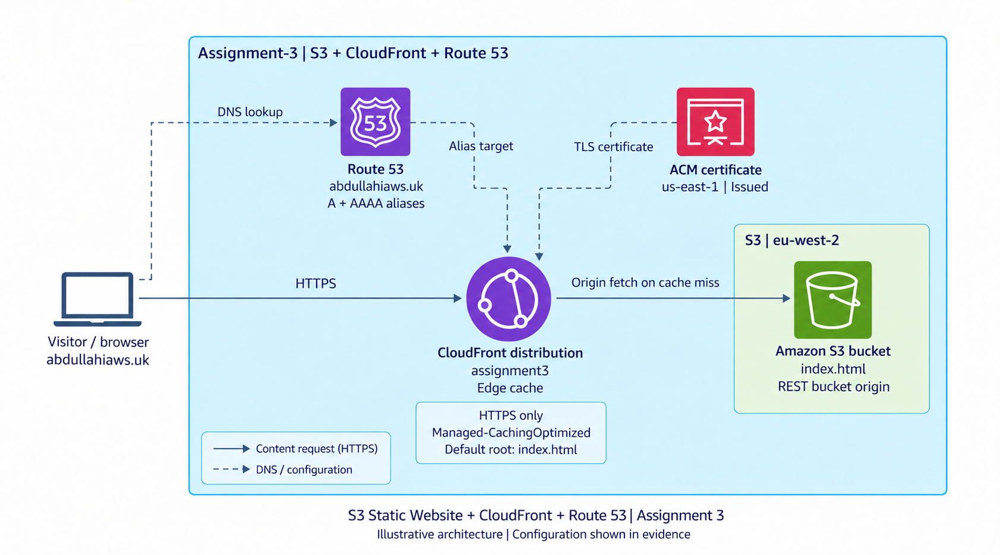

# Assignment 3 - S3 Static Website, CloudFront, and Route 53 evidence

These screenshots document the AWS console configuration and browser test on **25 October 2026**. The S3 bucket `asisignment-3` in `eu-west-2` stores the homepage. CloudFront distribution `assignment3` serves it at [https://abdullahiaws.uk](https://abdullahiaws.uk/), with Route 53 alias records and an issued ACM certificate. Cleanup has not been confirmed.

This is an architecture illustration, not an AWS console screenshot. It follows the same visual style as the VPC and ALB assignments and represents the regular S3 bucket origin shown in screenshot 4. Dashed connections show DNS and configuration relationships; the browser requests the content directly from CloudFront over HTTPS. The numbered screenshots follow the storage, distribution, domain, and browser verification sequence.

## Screenshots

1. [S3 homepage object](screenshots/01-s3-index-object.png) — bucket `asisignment-3` contains one object, `index.html`, sized `285 B` in S3 Standard. The matching [homepage source](../website/index.html) is included in this project.
2. [S3 static website hosting enabled](screenshots/02-s3-static-website-hosting-enabled.png) — hosting is `Enabled`, with hosting type `Bucket hosting` and website endpoint `http://asisignment-3.s3-website.eu-west-2.amazonaws.com`. The index and error document settings are not visible in this capture.
3. [S3 public access settings](screenshots/03-s3-block-public-access-settings.png) — `Block all public access` is `Off`. The two ACL-related blocking settings remain enabled; the two public-policy blocking settings are disabled. The bucket policy section is present, but its JSON is below the captured area.
4. [CloudFront S3 bucket origin](screenshots/04-cloudfront-s3-rest-origin.png) — the distribution has one origin, `asisignment-3.s3.eu-west-2.amazonaws.com`, with origin type `S3` and an empty origin path. An origin access identifier is visible; the full access configuration is not shown.
5. [CloudFront domain, certificate, and homepage settings](screenshots/05-cloudfront-domain-certificate-and-default-root.png) — distribution `assignment3` uses `d3lqalzpracrlv.cloudfront.net`, alternate domain `abdullahiaws.uk`, the attached custom certificate, and default root object `index.html`. Its security policy is `TLSv1.2_2021`.
6. [CloudFront default cache behavior](screenshots/06-cloudfront-https-only-cache-behavior.png) — the single `Default (*)` behavior routes to the S3 origin, uses viewer protocol policy `HTTPS only`, and applies `Managed-CachingOptimized`. The allowed methods and automatic compression setting are not visible in this list view.
7. [Route 53 domain records](screenshots/07-route53-a-and-aaaa-alias-records.png) — the public hosted zone `abdullahiaws.uk` has both `A` and `AAAA` alias records targeting `d3lqalzpracrlv.cloudfront.net`. The zone also contains NS, SOA, and certificate-validation CNAME records.
8. [Issued ACM certificate](screenshots/08-acm-certificate-issued-us-east-1.png) — an Amazon-issued certificate in `us-east-1` is `Issued` and `In use`. DNS validation for `abdullahiaws.uk` shows `Success`.
9. [Working website through the custom domain](screenshots/09-custom-domain-https-homepage.png) — the browser displays `Welcome to my website!` and `This is Abdullahi's static website.` at `abdullahiaws.uk`, with the secure connection indicator visible.

**Implementation notes:** S3 website hosting is enabled, but the configured CloudFront origin is the regular S3 bucket endpoint, not the website endpoint requested in the assignment brief. These are different origin types; the diagram records the configuration shown in the evidence. The viewer policy is `HTTPS only`, which rejects HTTP requests instead of redirecting them. The screenshots do not establish the complete bucket policy or whether direct public access to the website endpoint works.

**Troubleshooting:** During setup, `/index.html` loaded while `/` returned `Access Denied`. Setting the CloudFront default root object to `index.html` made the root URL load the homepage. Screenshot 5 records that setting, and screenshot 9 records the working result.

**Live validation:** The [DNS and HTTP verification log](validation/http-and-dns.txt), captured on **25 October 2026 at 12:37 UTC**, records `200` responses for both `/` and `/index.html`, with `X-Cache: Hit from cloudfront`. Public DNS returns IPv4 and IPv6 addresses and Route 53 nameservers. An HTTP request returns `403`, consistent with the captured HTTPS-only policy. `/error.html` also returns `403`.

**Remaining evidence:** the object list does not show `error.html`, and the current request for that path is denied; its upload and error-document configuration remain unverified. The complete bucket policy, allowed `GET`/`HEAD` methods, automatic compression setting, and a content-update/invalidation test are not captured. The origin difference from the website-endpoint brief is documented above.

## Privacy

The supplied screenshots were copied without changing their contents, and the original files were left unchanged. The repository copies retain the visible AWS account and resource identifiers, public domain, and DNS record details. The architecture image is an illustration; the console evidence consists of the nine supplied screenshots. Its generation method, references, and prompt are recorded in [architecture-prompt.md](architecture-prompt.md).
