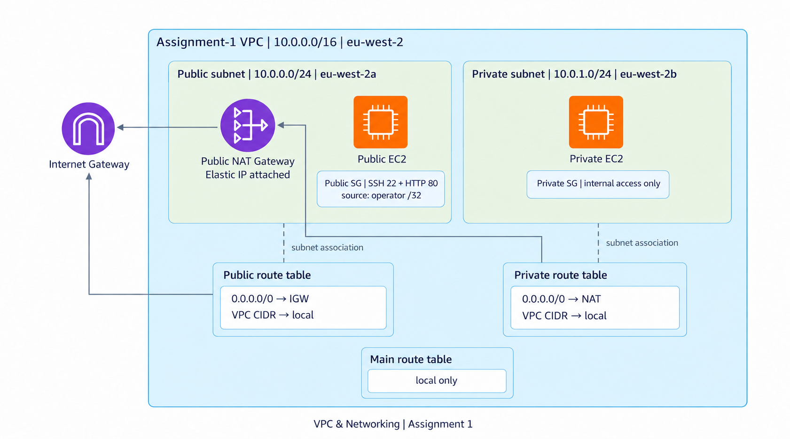

# VPC & Networking evidence

Screenshots are numbered in the order they tell the story: VPC and subnet setup, routing and security, then the final checks. The diagram is a style-matched summary of the project architecture. Public IP values and account identifiers are omitted.

The latest screenshots confirm the VPC, both subnets, the public and private route tables, an available public NAT gateway with an EIP, the active private default route, and the public EC2 instance. The project diagram includes both EC2 instances; the supplied instance-list screenshot currently shows only the public instance.

## Screenshots

1. [VPC created](screenshots/01-vpc-created.png) — `Assignment -1`, CIDR `10.0.0.0/16`.
2. [Public subnet](screenshots/02-public-subnet.png) — `10.0.0.0/24`, `eu-west-2a`.
3. [Private subnet](screenshots/03-private-subnet.png) — `10.0.1.0/24`, `eu-west-2b`.
4. [Internet gateway setup](screenshots/04-internet-gateway-created.png) — gateway creation screen.
5. [Internet gateway attachment](screenshots/05-internet-gateway-attach-form.png) — attachment to the assignment VPC; the later public route points to this gateway.
6. [Elastic IP detail](screenshots/06-elastic-ip-detail-unassociated.png) — this separate address was unassociated in that earlier screenshot; it is not the NAT gateway's current public address.
7. [NAT gateway setup](screenshots/07-nat-gateway-create-form.png) — creation screen.
8. [Public route table](screenshots/08-public-route-table-active.png) — active `0.0.0.0/0` route to the internet gateway and public subnet association.
9. [Private route table setup](screenshots/09-private-route-table-create-form.png) — creation screen.
10. [Private route setup](screenshots/10-private-route-edit-form-unverified.png) — the route before its saved state was captured; screenshot 17 confirms the final active route.
11. [Public security group setup](screenshots/11-public-security-group-create-form.png) — initial rules form; screenshot 20 shows the saved rules.
12. [Public EC2 instance](screenshots/12-public-ec2-running.png) — running `t2.micro` in the public subnet.
13. [Elastic IP list](screenshots/13-elastic-ip-list.png) — earlier address list; the newer NAT and resource-map screenshots show the current NAT gateway state.
14. [Public web endpoint](screenshots/14-public-web-endpoint.png) — browser displays the page served by EC2.
15. [Final AWS VPC resource map](screenshots/15-final-vpc-resource-map.png) — both subnets, three route tables, the internet gateway, and NAT gateway with one EIP are visible.
16. [NAT gateway details](screenshots/16-nat-gateway-available-eip.png) — NAT gateway is `Available` and `Public` in `public-subnet`; its public address is masked. The resource map shows one EIP attached.
17. [Private route and subnet association](screenshots/17-private-route-active-and-associated.png) — `0.0.0.0/0` routes to the NAT gateway with `Active` status; `private-subnet` is explicitly associated with this table.
18. [Route table inventory](screenshots/18-route-table-list-and-associations.png) — confirms the public, private, and main route tables. The first row is for a different VPC; the remaining three are for this assignment.
19. [EC2 instance list](screenshots/19-ec2-instance-list.png) — shows the running public instance with both instance status checks passed. Public IPv4 is masked.
20. [Saved public security group rules](screenshots/20-public-security-group-final-rules.png) — HTTP (TCP 80) and SSH (TCP 22) are restricted to the current public IP `/32`; the address is masked.

## Private EC2 evidence

Capture final-state screenshots that show the private instance and its security boundary:

1. **EC2 → Instances:** show both assignment instances, their state, and their subnet. Then select the private instance and capture its details showing `private-subnet`, its private IPv4, and no public IPv4 address.
2. **Private EC2 security group → Inbound rules:** show the saved rules and confirm access is limited to the intended internal source, such as the public instance's security group.

## Privacy

These are redacted copies of the supplied screenshots. AWS account details, personal public IP addresses, and public instance or gateway addresses are covered with solid masks. The original screenshots were left unchanged. Solid masks keep the covered values unreadable in the repository.
